# Biblioteca IPF — TP4

Aplicación de la biblioteca del Instituto Politécnico Formosa para consultar el catálogo, reservar libros, recibir recordatorios y que el personal entregue los libros respetando el orden de la lista de espera.

Trabajo Práctico N° 4 — Taller Complementario: React Native II.
Alumno/a: Fabiana Rossi.

## Versiones

- **Expo SDK 58.0.26**
- React Native 0.88.1
- React 19.3.0
- Expo Router 58.0.32
- TypeScript estricto (`strict: true`)
- Expo Go (SDK 58) para la prueba en el teléfono

## Cómo ejecutar

Requisitos: Node.js, npm y Expo Go instalado en el teléfono.

```bash
npm install
npx expo start
```

1. Escaneá el QR con Expo Go (el teléfono y la computadora tienen que estar en la misma red; si no, usá `npx expo start --tunnel`).
2. La app abre en la tab **Catálogo**.
3. Para entrar al área del personal, tocá **Personal** en el header del catálogo. Credenciales de demostración:
   - Usuario: `personal`
   - Clave: `ipf2026`

### Verificación

```bash
npx tsc --noEmit
npx expo lint
npx expo-doctor
```

Resultado en la última ejecución:

```text
$ npx tsc --noEmit
(compilación correcta, sin salida)

$ npx expo lint
(ESLint terminó sin errores)

$ npx expo-doctor
20/20 checks passed. No issues detected!
```

## Funcionalidades

- Catálogo con estados de carga, error con **Reintentar** y vacío.
- “Vistos recientemente” con una **Pila** (los 3 últimos, sin repetir el tope).
- Detalle validado por ISBN, con ejemplares disponibles y cantidad en espera.
- Buscador con la consulta `q` en la URL y descarte de respuestas viejas.
- Reserva con **Cola** por libro: préstamo a 7 días o lista de espera con posición.
- Escáner EAN-13 con los cuatro estados del permiso y fallback manual.
- Recordatorios locales a 15 segundos, con permiso pedido solo al activar “Recordarme”.
- Login y mostrador protegidos con `Stack.Protected`.
- Entrega al siguiente con notificación o aviso interno según el permiso.
- Redirección de `/reserva` a `/reservas` y pantalla 404 con la URL inexistente.

## Estructura de `src/`

```text
src/
├── app/                        Solo rutas
├── components/                 Componentes reutilizables
├── constants/                  Tema, credenciales, permisos y constantes
├── context/                    BibliotecaContext
├── data/                       Libros y esperas iniciales
├── estructuras/                Pila y Cola
├── hooks/                      useLibros, usePermiso, useBiblioteca, useRevisarAlVolver
├── lib/                        API simulada, catálogo, fechas, notificaciones, parámetros
└── types/                      Tipos de la app
```

### Árbol de `src/app`

```text
src/app/
├── _layout.tsx                         Stack raíz + provider + anchor '(tabs)' + Protected
├── (tabs)/
│   ├── _layout.tsx                     Tabs JS: Catálogo y Mis reservas
│   ├── (catalogo)/
│   │   ├── _layout.tsx                 Stack propio de la tab Catálogo
│   │   ├── index.tsx                   /
│   │   └── libro/[isbn].tsx            /libro/[isbn]
│   └── reservas.tsx                    /reservas
├── buscar.tsx                          /buscar?q=
├── escanear.tsx                        /escanear
├── reservar/[isbn].tsx                 /reservar/[isbn]  (modal)
├── permisos/[recurso].tsx              /permisos/[recurso] (modal)
├── login.tsx                           /login (modal, solo sin sesión)
├── mostrador.tsx                       /mostrador (solo con sesión)
├── reserva.tsx                         /reserva → Redirect a /reservas
└── +not-found.tsx                      404
```

| URL | Pantalla | Navegador |
|---|---|---|
| `/` | Catálogo | Tab “Catálogo”, con Stack propio |
| `/libro/[isbn]` | Detalle | Stack de la tab Catálogo |
| `/buscar?q=` | Buscador | Stack raíz |
| `/escanear` | Escáner EAN-13 | Stack raíz |
| `/reservar/[isbn]` | Confirmación de reserva | Stack raíz, modal |
| `/reservas` | Mis préstamos y esperas | Tab “Mis reservas” |
| `/permisos/[recurso]` | Pantalla previa de permisos | Stack raíz, modal |
| `/login` | Ingreso del personal | Stack raíz, modal, solo sin sesión |
| `/mostrador` | Mostrador | Stack raíz, solo con sesión |
| `/reserva` | Redirección | `<Redirect href="/reservas" />` |
| cualquiera | 404 | `+not-found.tsx` |

El `anchor: '(tabs)'` del layout raíz hace que un deep link a `/buscar`, `/escanear`, etc. deje las tabs debajo en la pila.

## `app.json`: bloque de plugins

El JSON no admite comentarios; este es el bloque real con una explicación al lado.

```jsonc
"plugins": [
  "expo-router",
  [
    "expo-splash-screen",
    {
      "backgroundColor": "#208AEF",
      "image": "./assets/images/splash-icon.png",
      "imageWidth": 76
    }
  ],
  [
    "expo-camera",
    {
      // Texto de propósito de iOS. En Android el diálogo lo maneja el sistema.
      "cameraPermission": "Usamos tu cámara para leer el código de barras del libro y abrir su ficha.",
      // La app no graba audio: no pedimos micrófono.
      "microphonePermission": false,
      "recordAudioAndroid": false
    }
  ],
  [
    "expo-notifications",
    {
      // Solo notificaciones locales; no usamos push remoto ni APNs.
      "enableRemoteNotifications": false
    }
  ]
]
```

## Permisos

| Recurso | Módulo / API | Cuándo se pide | Alternativa si se niega |
|---|---|---|---|
| Cámara | `expo-camera` (`useCameraPermissions`) | Al tocar **Escanear**, después de la pantalla previa `/permisos/camara`. | Escribir el ISBN a mano en `/escanear`. |
| Notificaciones | `expo-notifications` | Al activar **Recordarme** en un préstamo (y en la pantalla previa si la persona la abre y toca Continuar). | Avisos dentro de la app en **Mis reservas** y en el mostrador. |
| Micrófono | No se pide | — | — |
| Galería / almacenamiento | No se pide | — | — |
| Ubicación | No se pide | — | — |

## `blockedPermissions` y mínimo privilegio

En `app.json` bloqueamos permisos que la app no usa, para que ninguna dependencia los agregue de más:

```json
"blockedPermissions": [
  "android.permission.RECORD_AUDIO",
  "android.permission.READ_EXTERNAL_STORAGE",
  "android.permission.READ_MEDIA_IMAGES",
  "android.permission.READ_MEDIA_VIDEO",
  "android.permission.READ_MEDIA_AUDIO",
  "android.permission.ACCESS_BACKGROUND_LOCATION",
  "android.permission.ACCESS_FINE_LOCATION",
  "android.permission.ACCESS_COARSE_LOCATION"
]
```

- **RECORD_AUDIO**: la app solo lee códigos de barras, no graba audio ni video. `expo-camera` lo agregaría por defecto para video; lo desactivamos con `recordAudioAndroid: false` y además lo bloqueamos.
- **READ_EXTERNAL_STORAGE / READ_MEDIA_***: no se leen archivos, fotos, videos ni audio del teléfono.
- **ACCESS_*_LOCATION**: no se usa ubicación.
- No bloqueamos `CAMERA`, `POST_NOTIFICATIONS` ni `RECEIVE_BOOT_COMPLETED` porque la app sí los necesita.
- En iOS, `microphonePermission: false` evita `NSMicrophoneUsageDescription`; el texto de la cámara queda en `cameraPermission`.

## Deep links de prueba

En **Expo Go** el esquema propio no está disponible; se usa la URL equivalente:

```text
exp://IP:8081/--/RUTA
```

En un **development build** o app standalone se puede usar `bibliotecaipf://`.

| Ruta | Qué debería pasar |
|---|---|
| `/libro/9788420414706` | Detalle de *Rayuela*; tabs debajo. |
| `/libro/123` | Detalle con “El ISBN «123» no es válido…” y botón **Volver al catálogo**. |
| `/buscar?q=borges` | Buscador con la consulta y sus resultados; tabs debajo. |
| `/reservar/9788432248368` | Modal de confirmación de *El túnel* (sin ejemplares, posición en espera). |
| `/permisos/camara` | Pantalla previa de la cámara. |
| `/permisos/notificaciones` | Pantalla previa de notificaciones. |
| `/reservas` | Tab Mis reservas. |
| `/mostrador` sin sesión | Redirige a `/login`. |
| `/login` con sesión | Redirige a `/mostrador`. |
| `/reserva` | Redirige a `/reservas`. |
| `/ruta-inexistente` | 404 con la URL escrita. |

## Pruebas manuales sugeridas

1. **Catálogo**: abrir la app y ver el indicador; como `obtenerLibros` falla 1 de cada 5 veces, reintentar hasta ver el error y el botón **Reintentar**.
2. **Buscador**: escribir `bor` y rápido `borges`; solo deben quedar los resultados de la última búsqueda. Probar `zzzz` para el estado vacío.
3. **Detalle**: abrir un libro, ver disponibilidad y espera; probar un ISBN inválido y uno inexistente.
4. **Reserva**: reservar un libro con ejemplares (*Rayuela*) y uno sin ejemplares (*El túnel*); verificar la posición y que no se pueda reservar dos veces.
5. **Escáner**: probar los cuatro estados del permiso (concedido, preguntable, bloqueado y cargando), el ingreso manual y un ISBN desconocido.
6. **Recordatorio**: activar “Recordarme”, esperar 15 segundos y ver la notificación; desactivar o devolver antes de los 15 segundos y comprobar que no llega.
7. **Mostrador**: iniciar sesión, ver las listas iniciales, entregar a Ana/Bruno y luego a “Vos”; comprobar la notificación o el aviso en Mis reservas.
8. **Protección**: cerrar sesión y comprobar que el mostrador no vuelve con “atrás”; probar los deep links protegidos.

## Capturas

Las capturas se guardan en [`docs/capturas/`](docs/capturas/README.md). Hay tomas de la app en **Expo Go en un teléfono real** y capturas de la **versión web** para la vista previa. La lista de `docs/capturas/README.md` indica el origen de cada una.

| Catálogo cargando | Catálogo con error |
|---|---|
| 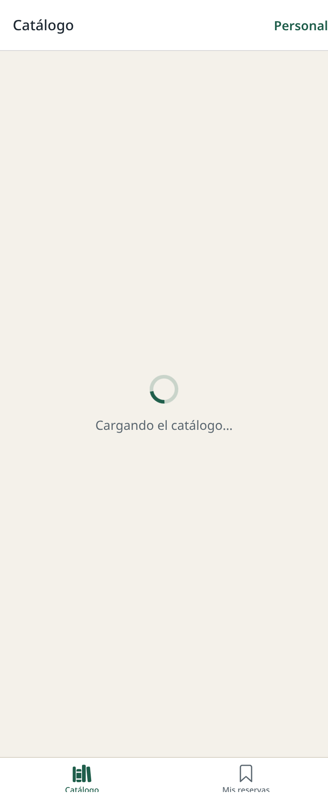 | 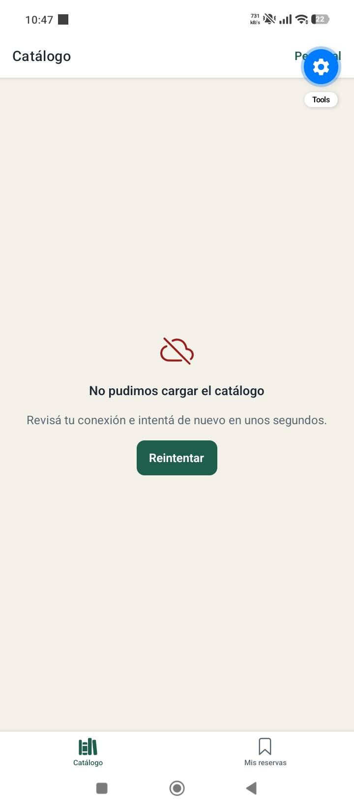 |

| Catálogo con datos | Buscador con resultados |
|---|---|
| 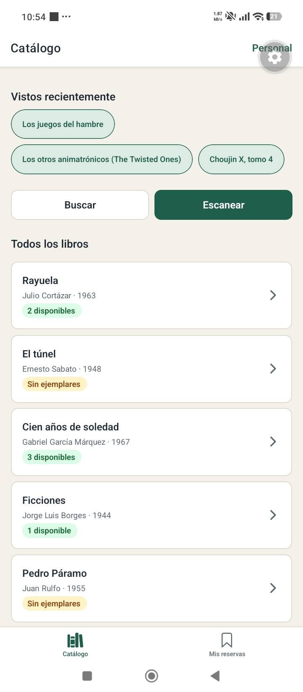 | 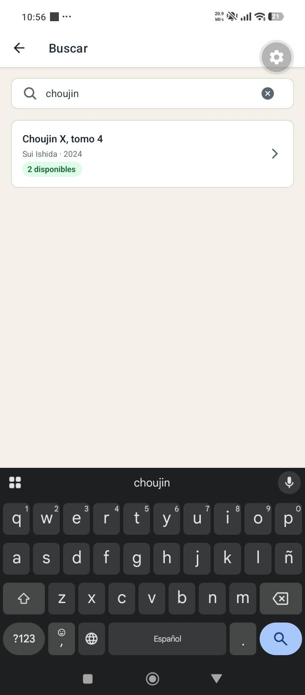 |

| Buscador sin resultados | Detalle |
|---|---|
| 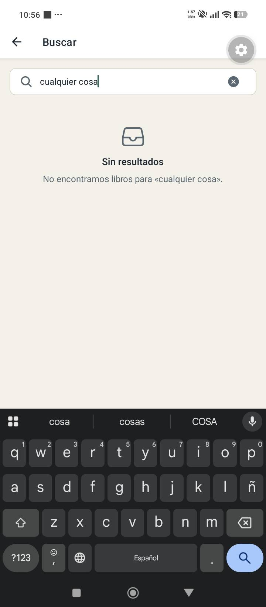 | 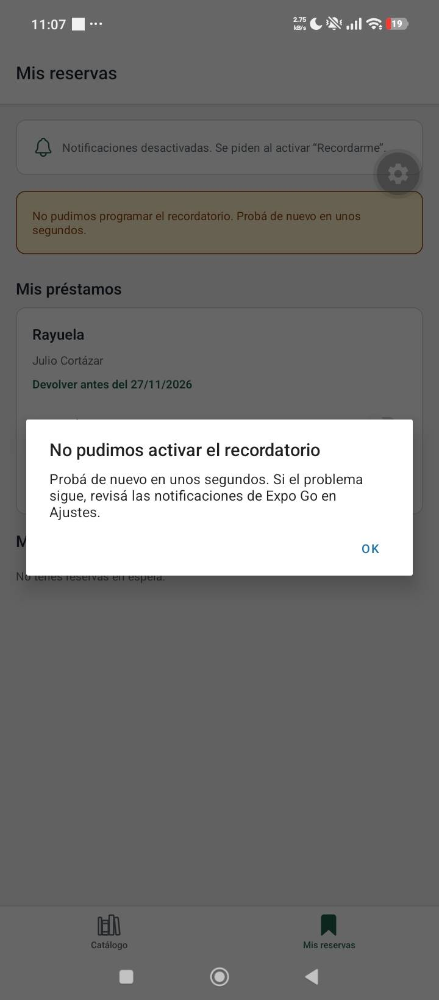 |

| Detalle inexistente | Reserva con ejemplares |
|---|---|
| 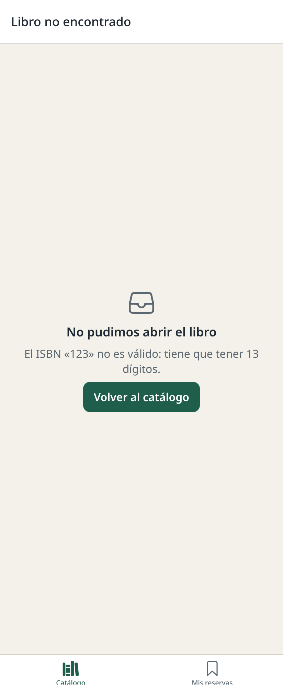 | 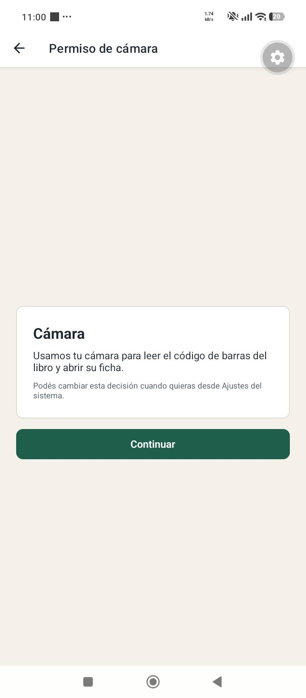 |

| Reserva sin ejemplares | Pantalla previa de cámara |
|---|---|
| 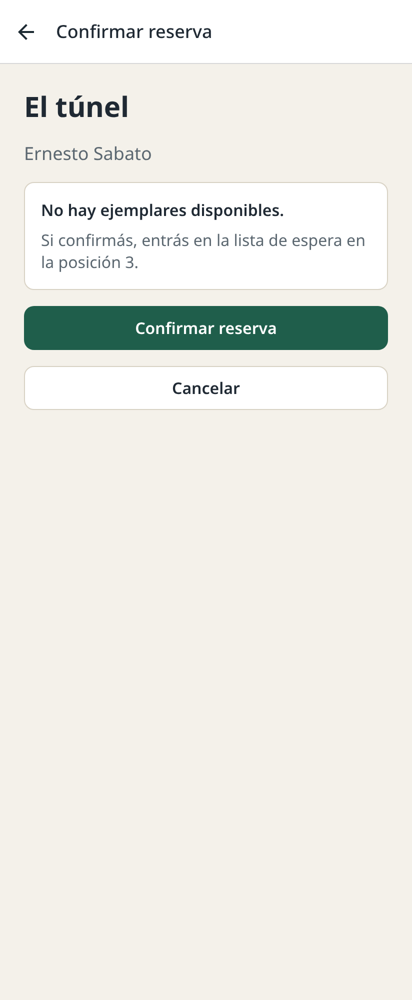 | 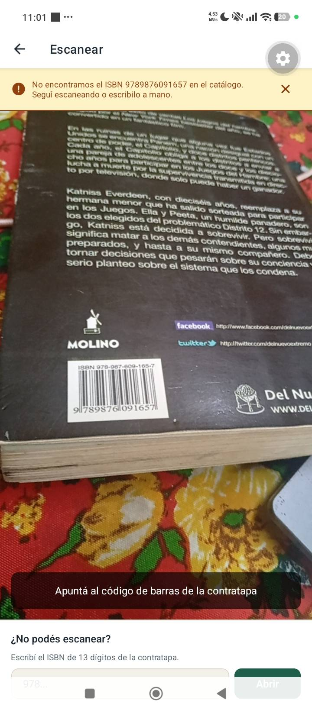 |

| Permiso del sistema (Expo Go) | Escáner preguntable |
|---|---|
| 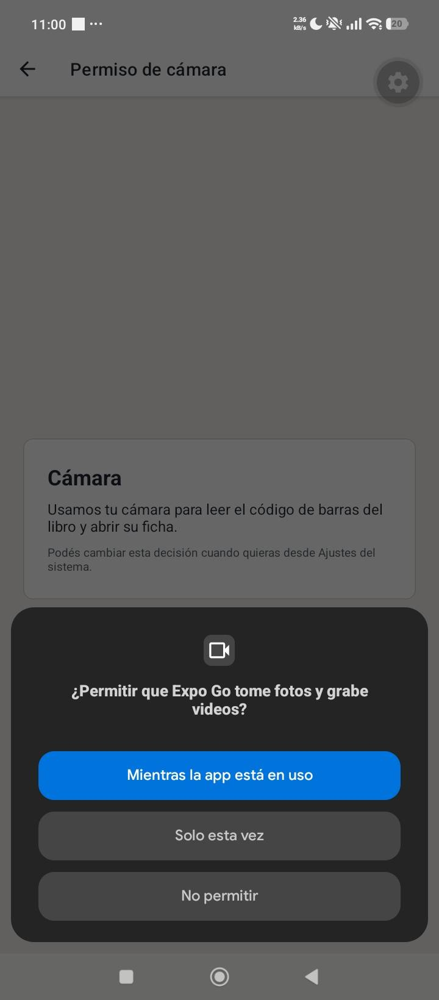 | 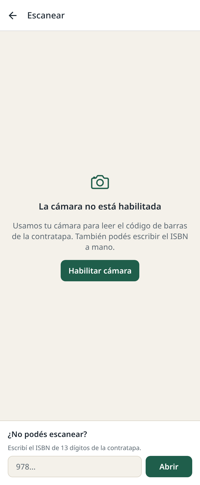 |

| Escáner concedido | Login |
|---|---|
| 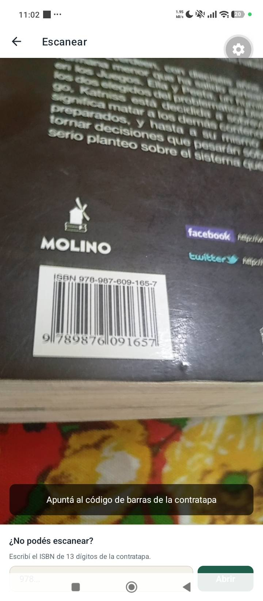 | 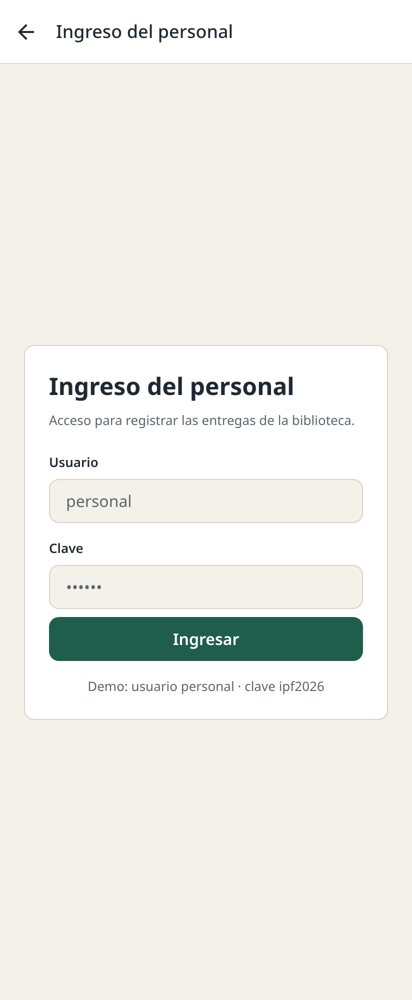 |

| 404 | Mis reservas |
|---|---|
| 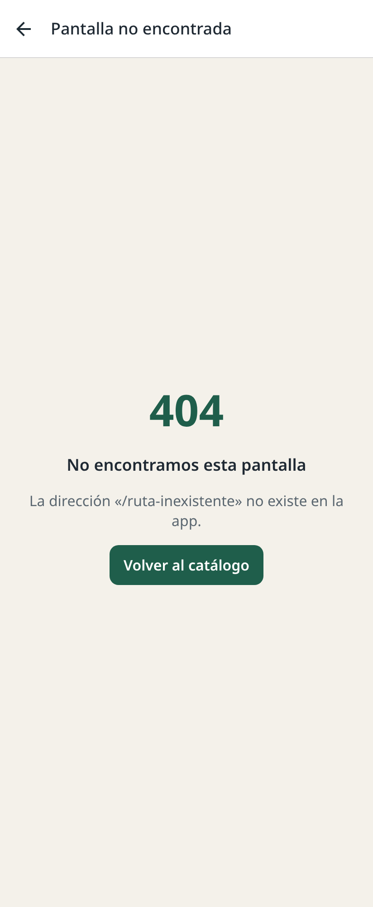 | 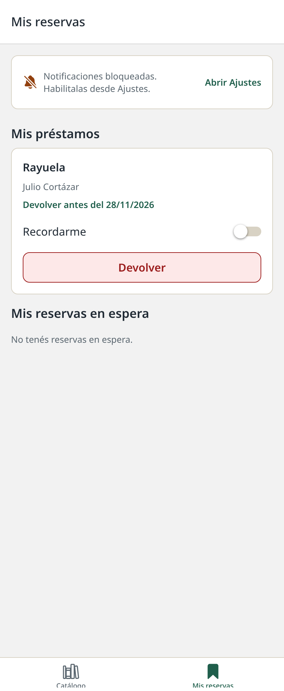 |

| Mostrador antes | Mostrador después |
|---|---|
| 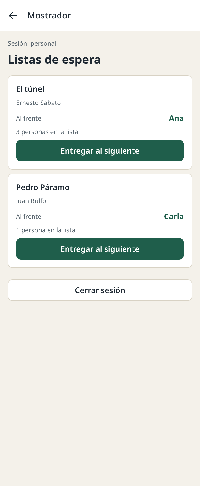 | 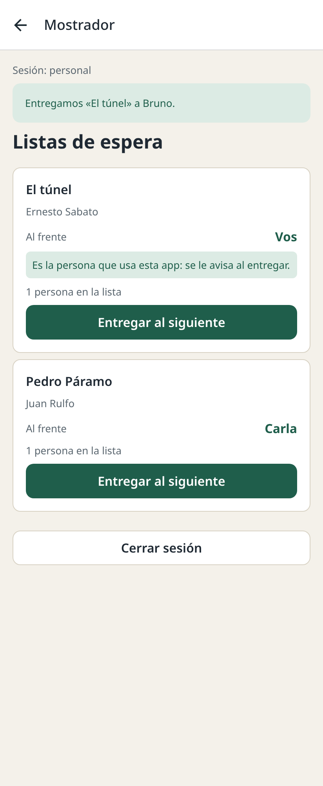 |

| Aviso interno | Detalle de Los otros animatrónicos |
|---|---|
| 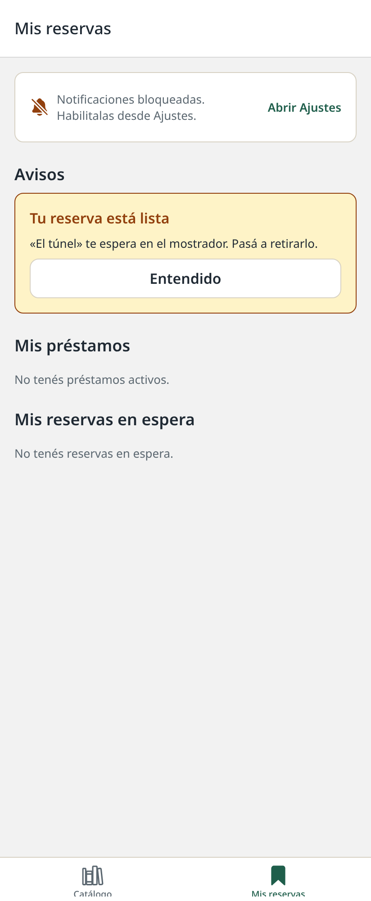 | 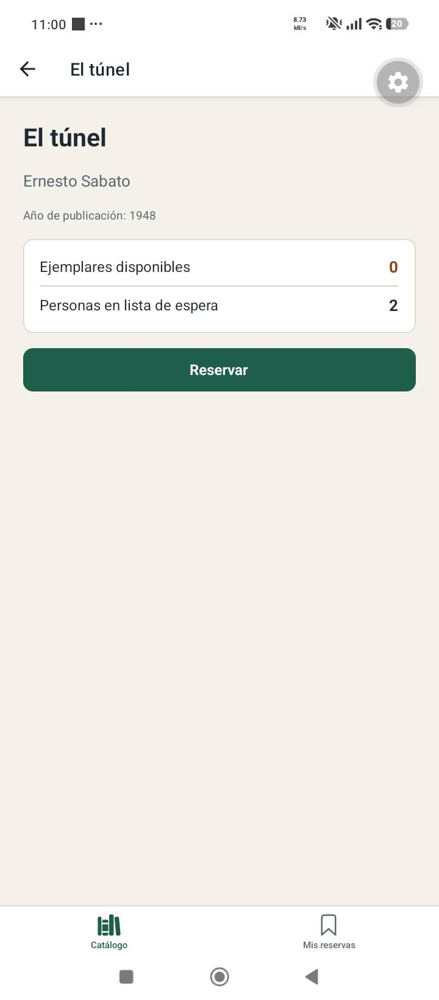 |


## Límites conocidos

- Los datos viven en memoria: al recargar la app se pierden préstamos, esperas, recientes y sesión. No se implementó persistencia (era un desafío opcional).
- El recordatorio se programa a 15 segundos en modo demostración.
- En Expo Go, el texto de propósito de la cámara, el `blockedPermissions` y el canal `prestamos` propio no se pueden verificar del todo: el diálogo y el manifiesto son de Expo Go. Se verifican con un development build.
- No se implementaron modo oscuro, tests con jest-expo ni debounce del buscador (desafíos opcionales).
